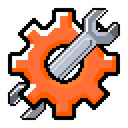

  

  # Quick Bar

  **A configurable on-screen quickbar for Factorio, designed for touch and controller play.**

  
  
  

---

**Quick Bar** adds an always-available item quickbar to Factorio, including **Pocket Foundry on Android**, where the usual desktop quickbar is replaced by controller-oriented controls.

The mod mirrors **Factorio's existing quickbar slots**. It does **not** create a separate inventory, and the regular `LB` quick panel remains available.

### Features

- **Horizontal or vertical layout**, with draggable positioning and adjustable edge margin.
- **Customizable size:** 28–68 px slots, 1–4 rows/groups, and 3–10 slots per row (or vertically in vertical mode).
- **Tap to build:** select an item or its ghost when the item is unavailable.
- **Vanilla filter picker** for empty slots, with Factorio's built-in search and categories.
- **Item counts and ghost indicators** inside quickbar slots.
- **Built-in editor:** drag grip, optional title, inventory-only selection, per-setting reset, Save and Cancel.
- **English and Russian** localization.

### Controls

| Action | How |
| --- | --- |
| Select an item | Tap a filled slot |
| Clear the selected item | Tap the selected slot again |
| Assign an empty slot | Tap it and use Factorio's native item picker |
| Open panel settings | Tap the settings icon |
| Change a filled slot | While editing, tap the slot, then tap it again to open the native picker |
| Move the panel | Open settings and drag the grip (or the title text when visible) |
| Switch quickbar page | Tap its page number |
| Restore its default page number | Long-press its number in Pocket Foundry, or right-click |
| Keep changes | Select **Save**, then save your Factorio game |

### Installation

**Pocket Foundry (Android)**

1. Download [`pocket-quickbar-touch_0.1.0.zip`](https://github.com/HinnliDev/Pocket-Quickbar-Touch/releases/download/v0.1.0/pocket-quickbar-touch_0.1.0.zip).
2. Open **Pocket Foundry → Settings → Files → mods**.
3. Copy the ZIP into `mods` **without extracting it**.
4. Start Factorio and confirm the mod is enabled under **Mods**.

**Desktop Factorio (Windows / Linux / macOS)**

Copy the ZIP to your Factorio mods directory, enable it in the Mods menu, and restart. The mod is primarily designed for controller mode. To use it with keyboard and mouse, disable **Only show in controller mode** in the per-player mod settings.

**Compatibility:** Factorio **2.1.x**, with or without Space Age. Requires `base >= 2.1.0` only.

**Note:** Save your game after changing the panel settings to keep them for that save.

## License

See [LICENSE](LICENSE) for the license terms.
