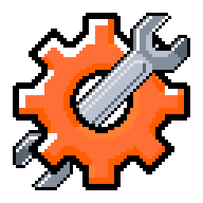

  

  # Быстрая панель

  **Настраиваемая экранная панель быстрого доступа для Factorio, предназначенная для сенсорного управления и геймпада.**

  
  
  

---

**Быстрая панель** добавляет в Factorio постоянно доступную панель быстрого выбора предметов, в том числе при игре через **Pocket Foundry на Android**, где привычная панель быстрого доступа для ПК заменена управлением, ориентированным на геймпад.

Мод использует **существующие слоты Quickbar в Factorio**. Он **не** создаёт отдельный инвентарь, а стандартная быстрая панель `LB` остаётся доступной.

### Возможности

- **Горизонтальное или вертикальное расположение** с возможностью перемещения и настройки отступа от края экрана.
- **Настраиваемые размеры:** слоты от 28 до 68 пикселей, от 1 до 4 строк/групп и от 3 до 10 слотов в ряду (или по вертикали в вертикальном режиме).
- **Выбор предмета касанием:** можно выбрать предмет для строительства или его призрак, если предмета нет в наличии.
- **Стандартный выбор фильтра Factorio** для пустых слотов со встроенным поиском и категориями.
- **Количество предметов и индикаторы призраков** внутри слотов панели.
- **Встроенный редактор:** решётка для перетаскивания, возможность скрыть заголовок, выбор только из инвентаря, сброс отдельных настроек, сохранение и отмена.
- **Русская и английская** локализации.

### Управление

| Действие | Как выполнить |
| --- | --- |
| Выбрать предмет | Нажать на заполненный слот |
| Убрать выбранный предмет | Повторно нажать на выбранный слот |
| Назначить пустой слот | Нажать на него и выбрать предмет в стандартном окне Factorio |
| Открыть настройки панели | Нажать на значок настроек |
| Изменить заполненный слот | В режиме редактирования нажать на слот, а затем ещё раз, чтобы открыть стандартное окно выбора |
| Переместить панель | Открыть настройки и перетащить решётку (или текст заголовка, если он виден) |
| Переключить страницу панели | Нажать на номер страницы |
| Вернуть стандартный номер страницы | Удерживать номер в Pocket Foundry или нажать правой кнопкой мыши |
| Сохранить изменения | Нажать **«Сохранить»**, затем сохранить игру Factorio |

### Установка

**Pocket Foundry (Android)**

1. Скачайте [`pocket-quickbar-touch_0.1.0.zip`](https://github.com/HinnliDev/Pocket-Quickbar-Touch/releases/download/v0.1.0/pocket-quickbar-touch_0.1.0.zip).
2. Откройте **Pocket Foundry → Settings → Files → mods**.
3. Скопируйте ZIP-архив в папку `mods`, **не распаковывая его**.
4. Запустите Factorio и убедитесь, что мод включён в разделе **Моды**.

**Factorio на ПК (Windows / Linux / macOS)**

Скопируйте ZIP-архив в папку модов Factorio, включите мод в меню «Моды» и перезапустите игру. Мод предназначен прежде всего для управления геймпадом. Для использования с клавиатурой и мышью отключите параметр **«Показывать только при управлении геймпадом»** в настройках мода для каждого игрока.

**Совместимость:** Factorio **2.1.x**, со Space Age или без него. Требуется только `base >= 2.1.0`.

**Примечание:** после изменения настроек панели сохраните игру, чтобы они сохранились в этом игровом сохранении.

## Лицензия

Условия использования указаны в файле [LICENSE](LICENSE).
